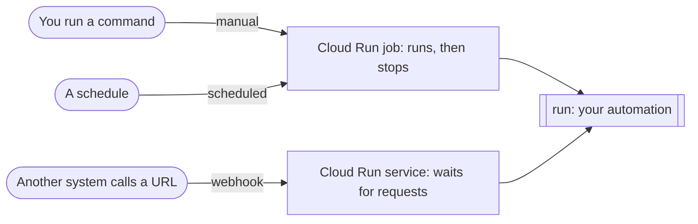

# Advanced AI Automation

The code for the free Advanced AI Automation course from the AI Developer Community. Business automations written in Python, built with Claude Code and Codex, and run on Google Cloud Run.

Four examples, in six files.

1. **Hello world**, deployed and started three ways: by hand, on a timer, and by a webhook.
2. **Speed to lead.** Someone fills in a form on a website. They get a proposal by email, written by AI, and the team hears in Slack.
3. **The research agent.** Every morning an agent researches your market and fills a spreadsheet with new prospects.
4. **Hacker News for AI developers.** Twice a day, the front page stories worth an AI developer's time go into a spreadsheet.

## The idea

An automation is a function called `run`. The last line of the file says what starts it.

```python
from toolkit import triggers

def run() -> dict:
    return {"message": "Hello, world!"}

if __name__ == "__main__":
    triggers.job(run)        # or: triggers.webhook(run)
```



## The examples

Read them in order. Each one adds one idea.

| File | What it does | Trigger | AI |
|---|---|---|---|
| [`01_manual.py`](automations/01_manual.py) | Says hello | Manual | None |
| [`02_scheduled.py`](automations/02_scheduled.py) | Says hello, every 5 minutes | Schedule | None |
| [`03_webhook.py`](automations/03_webhook.py) | Says hello to whoever calls it with the right token | Webhook | None |
| [`04_speed_to_lead.py`](automations/04_speed_to_lead.py) | When a website enquiry arrives, sorts it, tells the team in Slack, emails the prospect a proposal from your price list within a minute, and saves the lead | Webhook, signed | A decision model, then one writing call |
| [`05_research_agent.py`](automations/05_research_agent.py) | Every weekday at 7am, researches your market for companies that just raised money, hired a leader or opened a site, and adds them to the sales sheet | Schedule | An agent with three tools |
| [`06_hacker_news.py`](automations/06_hacker_news.py) | At 8am and 6pm every day, reads the Hacker News front page, keeps the stories relevant to AI developers, and adds the new ones to a sheet | Schedule | A decision model |

### Four kinds of step

Every step in an automation is one of these. Use the first one that can do the job.

| Step | What it does | In the examples |
|---|---|---|
| Plain code | Follows rules. Free, instant, the same every time | Checks the form, drops repeats, checks every price, sends, saves |
| A decision model | Answers a yes or no, picks one of a list, or scores on a scale. Returns a value and a probability, in a fraction of a second | Speed to lead: is it real, which service fits, how urgent is it? |
| A writing model, called once | Writes or reads, in a shape the code can check | Speed to lead: the proposal |
| An agent | Picks its own steps, using tools the code gives it | The research agent: what to search, what to open, when to stop |

The code stays in charge all the way up. It sets the thresholds on the decision model's probabilities. It checks every price the writing model quotes against [`services.md`](automations/services.md). And the agent can only act through three tools, where `save` refuses a company you already have and a link the agent never saw.

- **Speed to lead.** The first company to reply to an enquiry has a big head start, and most reply hours later. If either model fails, the team is still told and the lead is still saved.
- **The research agent.** A company that just showed a buying signal is a far better lead than one from a list. Nobody can write the searches down in advance, which is what makes this a job for an agent.
- **Hacker News.** The steps are known in advance, so there is no agent and nothing is written. Plain code reads the front page, the decision model scores each headline, and `KEEP` in the code sets the bar. Every row saves its score, so you can read the sheet and move the bar.

## The toolkit

[`automations/toolkit/`](automations/toolkit/) is the shared code. One idea per file.

| File | What it gives you |
|---|---|
| [`triggers.py`](automations/toolkit/triggers.py) | `triggers.job(run)` and `triggers.webhook(run)`, with a token or a signature check. One JSON log line per run |
| [`shadow.py`](automations/toolkit/shadow.py) | Shadow mode: everything runs and nothing is sent. On unless `SHADOW=false` |
| [`retry.py`](automations/toolkit/retry.py) | Tries a call again on a temporary failure, waiting longer each time |
| [`agent.py`](automations/toolkit/agent.py) | Gemini on Vertex AI, in the region you pick. `agent.ask(prompt, shape=...)` is one call, `agent.search(query)` searches Google, and `agent.run(goal, tools)` is the agent loop |
| [`decide.py`](automations/toolkit/decide.py) | `decide.ask(text, name=question, ...)`: quick judgments from a decision model. `yes_no`, `choice` and `score` questions, all in one request |
| [`web.py`](automations/toolkit/web.py) | `web.read(link)`: a page's text, for an agent to check a source |
| [`sheets.py`](automations/toolkit/sheets.py) | `sheets.read(tab)` and `sheets.add(tab, row)` |
| [`slack.py`](automations/toolkit/slack.py) | `slack.post(text)` |
| [`mail.py`](automations/toolkit/mail.py) | `mail.send(to, subject, text, key)` through Resend, safe to retry |

## Get started

New to Google Cloud, the terminal or Python? Follow [SETUP.md](SETUP.md). It covers installing the tools on Mac or Windows, creating the Google Cloud project, the settings file, the first deploy, and the errors people hit most.

If you have done this before, you need a Google Cloud project with billing on, the [gcloud CLI](https://cloud.google.com/sdk/docs/install) and [uv](https://docs.astral.sh/uv/). Docker is not needed: the image is built on Google Cloud.

```
git clone https://github.com/ai-developer-community/ai-automation-course.git
cd ai-automation-course
cp .env.example .env          # fill in PROJECT, WEBHOOK_TOKEN and WEBHOOK_SECRET
uv run pytest                 # uses fakes, no Google account needed
gcloud auth login
export CLOUDSDK_CORE_PROJECT=$(grep '^PROJECT=' .env | cut -d= -f2)
./deploy.sh
```

The script turns on the services, creates the `automations` service account and a second one that only builds the image, puts your secrets in Secret Manager, builds one image, deploys every automation and creates the schedules. At the end it prints a command to try each one, and the service account's email. Share your sheet with that email as Editor.

Get an email when anything fails:

```
ALERT_EMAIL=you@example.com ./alerts.sh
```

## Run the demos

[DEMO.md](DEMO.md) has every demo from the course in order, on your laptop and on Google Cloud, with the commands to copy.

## Going live

Everything starts in shadow mode. Run it on real data, read the `"would"` lines in the logs, and when you're happy set `SHADOW=false` in `.env` and run `./deploy.sh` again.

## Credentials

Each automation runs as the `automations` service account, which can call Gemini on Vertex AI and can only open the sheets you share with it. There is no key file and no key for the writing model.

Five secrets are left: the webhook token, the webhook signing secret, the Slack webhook address, the Resend key, and one key for the decision model. That last one is temporary. Google launched the Decisions API on its developer platform first, which signs in with an API key from [Google AI Studio](https://aistudio.google.com/apikey). When the API reaches Google Cloud, delete `GEMINI_API_KEY` and the same code signs in as the service account. Without a key, speed to lead skips the decision step and still works. `deploy.sh` copies them from `.env` into Secret Manager, and Cloud Run hands them to the automation when it starts. `.env` is in `.gitignore`. Never commit it.

## Other ways to do this

A job on Cloud Run with a scheduler is one way to run an automation. These are the others worth knowing.

| Kind | Options | Reach for it when |
|---|---|---|
| The same idea on another cloud | [AWS Lambda](https://docs.aws.amazon.com/lambda/latest/dg/welcome.html) with [EventBridge Scheduler](https://docs.aws.amazon.com/scheduler/latest/UserGuide/what-is-scheduler.html), [Azure Container Apps jobs](https://learn.microsoft.com/en-us/azure/container-apps/jobs) | The business is on AWS or Azure. A Lambda function is stopped at 15 minutes |
| Workflow services: the steps go in a config file | [Google Cloud Workflows](https://docs.cloud.google.com/workflows/docs/overview), [AWS Step Functions](https://docs.aws.amazon.com/step-functions/latest/dg/welcome.html), [Azure Logic Apps](https://learn.microsoft.com/en-us/azure/logic-apps/logic-apps-overview) | A run has to wait hours or days for a person or another system |
| Durable execution: the steps are code, saved as they finish | [Temporal](https://temporal.io/), [Inngest](https://www.inngest.com/), [Trigger.dev](https://trigger.dev/), [Cloudflare Workflows](https://developers.cloudflare.com/workflows/) | A long process should carry on from the step that failed |
| Data pipeline schedulers | [Apache Airflow](https://airflow.apache.org/), [Prefect](https://www.prefect.io/) | You have dozens of jobs that feed each other |

The examples here need none of them. Each is one short job that is safe to run twice. Add one when a run has to wait, or has to pick up where it left off.
